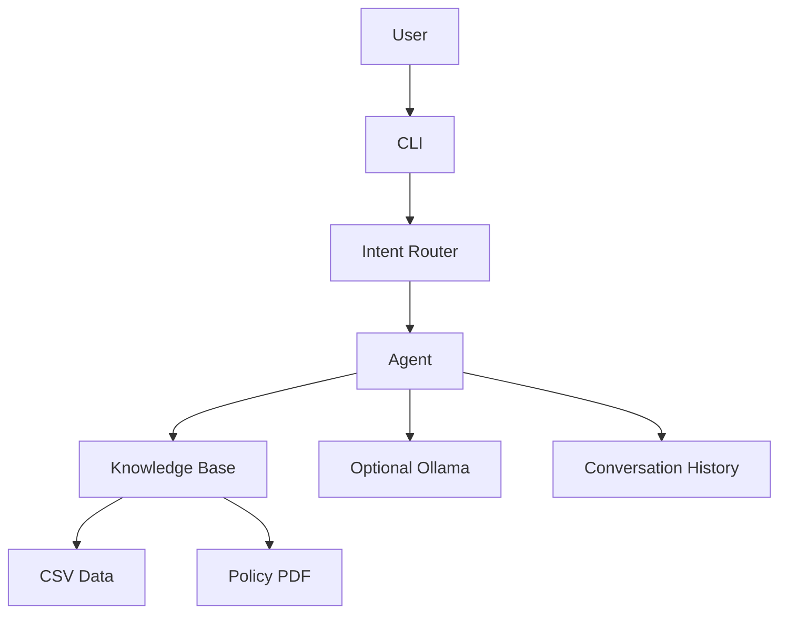

# Empório da Música — Customer Service Agent

A prototype text-based customer service agent for **Empório da Música**, a fictional musical-instrument store based in Campo Grande, Brazil.

The agent answers questions about products, orders, promotions, and store policies. Its core behavior is grounded in the local CSV and PDF data, with a predictable rule-based fallback when an optional language model is not available.

> The application intentionally communicates in Brazilian Portuguese. This README and the technical documentation are written in English for easier sharing and maintenance.

## Features

- Product price, description, stock, catalog status, and active-promotion lookup.
- Product category and budget filters, such as listing violões up to R$ 1,000.
- Order status, total, tracking code, items, and estimated-delivery lookup.
- Store-policy lookup for opening hours, payments, exchanges, returns, warranty, shipping, discounts, and privacy.
- Explicit handling of out-of-scope items, such as accessories that are not part of the catalog.
- Predictable fallback responses when the intent is unknown or data is missing.
- Local conversation-history persistence support.
- Brazilian Portuguese responses with a friendly, professional tone.

## Requirements coverage

The main workflow addresses the challenge requirements as follows:

- **Store persona:** the agent identifies itself as Empório da Música customer service and uses Brazilian Portuguese.
- **Context-aware responses:** each message is classified and answered using the loaded CSV data, policy text, and optionally a local model.
- **Grounded retrieval:** product and order questions use structured records; policy questions use the store-policy PDF.
- **Out of scope:** unsupported items are detected before product lookup and receive an explicit explanation instead of an invented availability result.

## Quick start

### Prerequisites

- Python 3.10 or later.
- The CSV files and the policy PDF in the [`data/`](./data/) directory.

### Installation

```bash
python -m venv .venv
```

Activate the virtual environment:

```powershell
# Windows PowerShell
.venv\Scripts\Activate.ps1
```

```bash
# Linux/macOS
source .venv/bin/activate
```

Install dependencies:

```bash
pip install -r requirements.txt
```

### Run the CLI

```bash
python cli.py
```

Available commands:

- `/ajuda` or `/help` — show example questions.
- `/historico` — show the five most recent saved interactions.
- `/limpar` — clear the saved conversation history.
- `/status` — show loaded data, mode, model, and history diagnostics.
- `/debug <question>` — show the detected intent, confidence, and entities.
- `/sair`, `/exit`, or `/quit` — exit the application.

The default mode is deterministic and does not require a model server.

To use a local Ollama model to rewrite the grounded responses, start Ollama and run:

```bash
python cli.py --ollama
```

The default model is `llama3.2:latest`. You can select another installed model:

```bash
python cli.py --ollama --ollama-model gemma3:latest
```

If Ollama is unavailable or the selected model fails, the agent keeps the deterministic local response.

Validate the local CSV and PDF data without starting the interactive interface:

```bash
python cli.py --check
```

### Run the smoke tests

```bash
python test_agent.py
```

## Data sources

The [`data/`](./data/) directory contains:

- CSV files for categories, customers, orders, order items, products, and promotions.
- `políticas_da_loja.pdf`, the store policy manual used as the policy source.

All data is fictional and intended for demonstration only. It must not be treated as a production customer or order database.

## Architecture

The project uses a small hybrid architecture:

1. [`intent_router.py`](./intent_router.py) classifies a message as `GREETING`, `PRODUCT_INFO`, `ORDER_STATUS`, `POLICY`, `OUT_OF_SCOPE`, or `UNKNOWN`.
2. The router extracts simple entities such as an order number, product query, or policy topic using keywords and regular expressions.
3. [`data_loader.py`](./data_loader.py) loads the CSV files and extracts policy text with `pdfplumber`, falling back to `pypdf`.
4. [`knowledge_base.py`](./knowledge_base.py) normalizes values, creates in-memory indexes, and performs product, order, and policy lookups.
5. [`agent.py`](./agent.py) orchestrates intent handling and produces grounded responses.
6. [`cli.py`](./cli.py) provides the interactive command-line interface.

This is not a ReAct, function-calling, SQL-agent, or vector-database implementation. Explicit routing keeps lookups auditable and avoids arbitrary model-generated queries over local files.



## Framework and agent approach

The project uses a deliberately small **hybrid approach**:

- deterministic intent classification and entity extraction;
- structured retrieval from CSV files;
- keyword-based retrieval from the policy PDF;
- deterministic response templates for reliable facts;
- optional local LLM rewriting through Ollama.

This approach was chosen over ReAct, function calling, and a SQL agent because the data set is small and known in advance. Explicit handlers make prices, stock, orders, and policies easier to audit and test.

## Model and provider

The default provider is the local deterministic pipeline: no model, API key, network connection, or paid service is required. The optional provider is **Ollama**, accessed through its local HTTP endpoint.

The default Ollama model is `llama3.2:latest`, configurable with `--ollama-model` or the `OLLAMA_MODEL` environment variable. The endpoint defaults to `http://127.0.0.1:11434` and can be changed with `OLLAMA_URL`.

The LLM is not the source of truth. It is asked only to rewrite an already grounded answer. If the service is unavailable, the selected model fails, or the response is unsafe for a factual answer, the deterministic response is retained.

## Retrieval architecture

- Structured records are loaded into memory and indexed by ID and name.
- Policy text is extracted from the PDF and searched by topic keywords.
- Search text is normalized to make matching less sensitive to accents and formatting.
- Only records relevant to the detected intent are used to build the response context.

No vector database is used because the source data is small, local, and structured. Product category and maximum-price filters are applied directly to structured fields such as `category_id` and `price_brl`.

## Prompt strategy

When `--ollama` is enabled, the prompt contains:

1. the customer's original question;
2. the deterministic answer retrieved from the local data;
3. instructions to answer in Brazilian Portuguese;
4. an instruction not to add prices, addresses, policies, or availability not present in the grounded answer.

The prompt intentionally gives the model a wording role rather than a retrieval or database-query role. This reduces hallucination risk and keeps the local data authoritative.

## Conversation history

Conversation history is implemented in [`conversation_history.py`](./conversation_history.py), using [`conversation_history.json`](./conversation_history.json) as its default storage file. Each record contains a timestamp, the user message, and the agent response. The implementation keeps the 100 most recent exchanges. The CLI exposes `/historico` and `/limpar`.

## Repository structure

```text
agente-atendimento/
├── data/                       # CSV data and the policy PDF
├── examples/                   # Example conversations
├── data_loader.py              # CSV loading and PDF text extraction
├── knowledge_base.py           # Normalization, indexes, and lookups
├── intent_router.py            # Intent classification and entity extraction
├── agent.py                    # Agent orchestration and fallbacks
├── conversation_history.py     # Local history persistence
├── ollama_client.py            # Optional Ollama HTTP client
├── cli.py                      # Interactive command-line interface
├── test_agent.py               # Smoke tests
├── requirements.txt            # Python dependencies
├── README.md                   # Project overview
└── docs/
    ├── PROJECT_DOCUMENTATION.md    # Detailed technical documentation
    ├── PROJECT_DOCUMENTATION.html   # Print source for the PDF
    └── PROJECT_DOCUMENTATION.pdf    # Printable documentation
```

## Examples

Four example conversations are available in [`examples/`](./examples/):

- [Catalog lookup](./examples/01-consulta-catalogo.md)
- [Order status](./examples/02-status-pedido.md)
- [Return policy](./examples/03-politica-devolucao.md)
- [Out-of-scope request](./examples/04-fora-do-escopo.md)

Typical questions include:

```text
Você: qual o preço da guitarra Yamaha FG800?
Agente: Yamaha FG800 Dreadnought Natural — R$ 1.299,00

Você: qual o status do pedido #1?
Agente: Olá, Pedro Henrique Oliveira! Seu pedido #1 está delivered.

Você: qual o horário de funcionamento?
Agente: Segunda a Sexta-feira 09:00 às 18:00
```

## Known limitations and next steps

- Intent routing is keyword-based; ambiguous wording and unknown synonyms may be classified as `UNKNOWN`.
- Product search is lexical and does not use embeddings or reranking.
- History is a local JSON file without authentication, multi-process coordination, or per-user separation.
- Order lookup accepts the order number from the message and has no customer authentication or real order-system integration.
- Error handling and the CLI are suitable for a prototype, not a production deployment.
- The optional Ollama integration depends on local environment configuration.
- The current tests are a smoke test rather than a complete unit and integration test suite.
- Ollama response quality depends on the selected local model and available hardware; deterministic answers remain the fallback.

Potential next steps include automated edge-case tests, startup data validation, authenticated order lookup, an API or web UI, transactional persistence, monitoring, and hybrid structured-plus-semantic catalog search.

## Technical trade-offs

### Deterministic routing instead of an autonomous agent

- The data set is small and known in advance.
- Explicit handlers make answers auditable and reproducible.
- The design reduces hallucinations and avoids arbitrary database queries.
- The trade-off is less flexibility with ambiguous or unforeseen wording.

### Ollama instead of a hosted API

- It runs locally without credentials or per-request cost.
- It keeps demonstration data on the local machine.
- It supports offline deterministic fallback behavior.
- The trade-off is dependence on local hardware and model availability.

### CLI instead of a web UI

- The challenge explicitly allows a CLI.
- It keeps the focus on agent behavior and retrieval quality.
- It is easy for an evaluator to install and reproduce.
- The trade-off is a less polished end-user experience than a web interface.

### JSON history instead of a database

- It is dependency-free and appropriate for a single-user prototype.
- It is easy to inspect and reset during evaluation.
- The trade-off is no multi-user isolation, transactions, or concurrent-write protection.

## Documentation and PDF

The detailed technical documentation is available in [`docs/PROJECT_DOCUMENTATION.md`](./docs/PROJECT_DOCUMENTATION.md). A printable PDF is also included at [`docs/PROJECT_DOCUMENTATION.pdf`](./docs/PROJECT_DOCUMENTATION.pdf).

## Use of coding assistants

**Copilot SDK in VS Code** was used as a development assistant. The workflow was:

1. inspect the repository and reproduce behavior locally;
2. use Copilot to investigate bugs and suggest implementation options;
3. apply only changes that matched the project requirements;
4. review the generated code and data-flow decisions manually;
5. run smoke tests, syntax checks, and focused behavior checks;
6. use Copilot to organize and review the README, technical documentation, and PDF source.

Copilot did not replace validation or design decisions. The implementation, test results, local Ollama behavior, and final documentation were checked in the repository environment.
